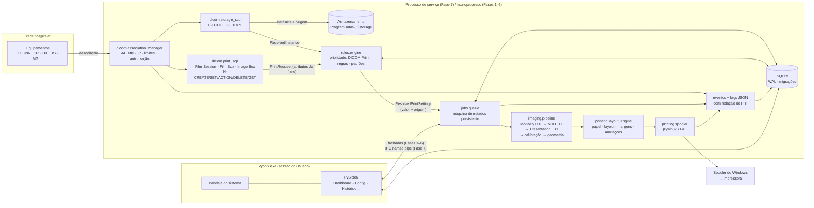

# VYONIX DICOM Print — Arquitetura Técnica

> **VYONIX DICOM Print** · *Precisão em cada imagem.*
> Documento de arquitetura — revisão 1 (Fase 1). Plataforma-alvo: Windows 10/11 64 bits.
>
> **Aviso:** este software está em desenvolvimento e **não está validado para uso clínico**.
> Nenhuma declaração de conformidade DICOM ou aptidão assistencial é feita por este documento.

---

## 1. Visão geral

O VYONIX é dividido em **dois processos** e **camadas independentes**:

| Processo | Execução | Responsabilidade |
|---|---|---|
| `VyonixService` (Fase 7) | Serviço Windows, sessão 0, conta `LocalService` ou conta dedicada | DICOM Storage SCP, DICOM Print SCP, pipeline de imagens, motor de regras, fila e spooler. Funciona com a interface fechada. |
| `Vyonix.exe` | Sessão interativa do usuário | Interface PySide6, bandeja do sistema, administração. Nunca roda dentro do serviço. |
| `VyonixLicenseAdmin` (Fase 8) | Máquina do fabricante, **nunca distribuída** | Emissão e assinatura (Ed25519) de licenças. Contém a chave privada. |

Até a Fase 7, o núcleo roda dentro do processo da interface (modo "monoprocesso") usando **exatamente
os mesmos módulos** — a separação em serviço muda apenas *onde* os módulos são instanciados, não o código deles.
Isso é garantido pela regra de dependência abaixo.

### 1.1 Regra de dependência (camadas)

```
 ui  ──►  services  ──►  domínio (dicom, imaging, printing, rules, jobs, devices, licensing)
                │                    │
                └──────►  core (contratos, DTOs, erros)  ◄──┘
                                     ▲
                      database / security / utils (infraestrutura)
```

* `app/core` não importa nada do projeto. Define **contratos** (`typing.Protocol`) e **DTOs** imutáveis.
* Módulos de domínio dependem apenas de `core` e da infraestrutura. **Nenhum módulo de domínio importa Qt.**
* `app/ui` é a única camada que importa PySide6. Ela conversa somente com `services` (fachadas).
* Na Fase 7, `services` ganha uma implementação cliente (IPC) com a mesma interface — a UI não muda.

---

## 2. Diagrama de módulos e fluxo de dados



Representação textual (para leitores sem Mermaid):

```
Equipamento ─assoc─► AssociationManager ─┬─► StorageSCP (C-ECHO, C-STORE) ─► storage/ + instances (DB)
                                         │                                 └─► ReceivedInstance
                                         └─► PrintSCP (N-CREATE/SET/ACTION/DELETE/GET) ─► PrintRequest
ReceivedInstance / PrintRequest ─► RulesEngine ─► ResolvedPrintSettings (cada campo com ORIGEM)
                                                        │
                                                        ▼
                         JobQueue (estados persistentes, idempotência, retentativas)
                                                        │
             ImagePipeline ─► LayoutEngine ─► Spooler (pywin32) ─► Spooler do Windows ─► Impressora
                                                        │
                      Eventos/Logs (PHI redigido) ─► SQLite + logs JSON rotativos ─► UI (Histórico)
```

### 2.1 Fluxo de um trabalho

1. **Recebido** — Storage SCP grava o arquivo original (imutável) e registra a instância; ou o Print SCP recebe `N-ACTION (Print)` de uma Film Session/Film Box.
2. **Validando** — verificação de equipamento autorizado, integridade do arquivo, transfer syntax suportada.
3. **Processando** — o motor de regras resolve as configurações (cada parâmetro carrega sua origem: `dicom_print`, `rule:<id>`, `custom`, `default`); o pipeline renderiza; o motor de layout compõe páginas.
4. **Aguardando impressão** → **Enviado ao sistema de impressão** (spooler aceitou o trabalho; *não* significa papel impresso).
5. **Concluído** somente quando houver confirmação confiável do driver/impressora; caso contrário o estado final permanece "Enviado".
6. **Falhou / Cancelado / Retido** com motivo registrado e histórico de transições.

A máquina de estados está implementada em `app/jobs/states.py` desde a Fase 1 e é espelhada por um `CHECK` no banco.

---

## 3. Contratos entre módulos

Definidos em `app/core/contracts.py` (Fase 1). Resumo:

| Contrato | Implementação prevista | Responsabilidade |
|---|---|---|
| `DicomService` | `dicom.storage_scp`, `dicom.print_scp` | `start()`, `stop()`, `status()` |
| `InstanceSink` | `jobs` / `services` | recebe `ReceivedInstance` do Storage SCP |
| `PrintRequestSink` | `jobs` / `services` | recebe `PrintRequest` do Print SCP |
| `ImagePipeline` | `imaging.pipeline` | `render(source, params) -> RenderedImage` |
| `LayoutEngine` | `printing.layout_engine` | `compose(images, page_spec) -> list[ComposedPage]` |
| `PrinterBackend` | `printing.printer_manager` (pywin32) | listar impressoras, capacidades, enviar ao spooler |
| `RulesEngine` | `rules.engine` | `resolve(context) -> ResolvedPrintSettings`, `simulate(context)` |
| `LicenseValidator` | `licensing.validator` | `status() -> LicenseStatus` |
| `EventSink` | `database.repositories.events` | registro de eventos auditáveis |

DTOs principais: `ReceivedInstance`, `PrintRequest`, `ResolvedSetting(value, origin, reference)`,
`ResolvedPrintSettings`, `PrinterInfo`, `SpoolResult`, `ServiceStatus`, `LicenseStatus`.

Princípio: **DTOs nunca carregam dados de paciente além do mínimo necessário** (UIDs, modalidade, AE de origem).
Dados demográficos ficam apenas no arquivo DICOM original e nas anotações de impressão, quando configuradas.

---

## 4. Modelo de dados (SQLite, migração `0001_initial`)

Convenções: datas em texto ISO‑8601 UTC (`2026-10-20T17:53:00.000Z`); JSON validado com `json_valid`;
chaves estrangeiras ativas; journal WAL; `synchronous=FULL` (prioriza durabilidade da fila).

| Tabela | Finalidade | Campos-chave |
|---|---|---|
| `schema_migrations` | controle de versão do esquema | `version`, `name`, `checksum` (SHA-256), `applied_at` |
| `settings` | configurações tipadas (chave → JSON) | `key`, `value_json`, `updated_at`, `updated_by` |
| `change_history` | histórico de alterações administrativas | `entity_type`, `entity_id`, `field`, `old_value`, `new_value`, `changed_by`, `reason` |
| `events` | eventos operacionais e de auditoria | `ts`, `level`, `category`, `action`, `message`, `device_id`, `job_id`, `actor`, `details_json` |
| `printers` | impressoras Windows conhecidas | `name` (único), `driver_name`, `capabilities_json`, `is_default`, `last_status` |
| `print_profiles` | perfis de impressão/calibração | `paper_size`, `orientation`, `layout`, `margins_json`, `calibration_json`, `copies`, `annotations_json` |
| `profile_bindings` | associação perfil ↔ impressora/equipamento/modalidade | `profile_id`, `scope_type`, `scope_value` |
| `devices` | equipamentos DICOM | `name`, `manufacturer`, `model`, `modality`, `ae_title` (único, ativo), `ip_address`, `port`, `site`, `department`, `printer_id`, `print_profile_id`, `authorized`, `active`, `last_seen_at` |
| `rules` | regras automáticas | `name`, `conditions_json`, `actions_json`, `priority`, `active` |
| `instances` | instâncias recebidas (sem demografia) | `sop_instance_uid` (único → detecção de duplicatas), `study_uid`, `series_uid`, `sop_class_uid`, `modality`, `transfer_syntax`, `file_path`, `file_sha256`, `source_ae`, `source_ip`, `device_id` |
| `print_sessions` | estado do DICOM Print SCP (Film Session/Box/Image Box) | `association_id`, `sop_instance_uid`, `kind`, `attributes_json` |
| `jobs` | fila persistente | `uuid`, `idempotency_key` (único → evita duplicidade), `source_type`, `state`, `state_reason`, `printer_id`, `profile_id`, `rule_id`, `settings_json`, `settings_origin_json`, `page_count`, `copies`, `attempts`, `max_attempts`, `spool_job_id` |
| `job_items` | instâncias que compõem o trabalho | `job_id`, `instance_id`, `position` |
| `job_state_history` | trilha de transições | `job_id`, `from_state`, `to_state`, `actor`, `reason`, `at` |
| `licenses` | licenças instaladas | `license_id`, `edition`, `features_json`, `installation_id`, `issued_at`, `expires_at`, `signature`, `raw`, `status` |

O DDL completo está em `app/database/migrations/m0001_initial.py`.

---

## 5. Armazenamento em disco

Nunca no diretório do executável. Resolução em `app/utils/paths.py`:

| Uso | Windows | Observação |
|---|---|---|
| Dados da máquina (BD, imagens, cache, backups, logs do serviço) | `%ProgramData%\VYONIX\DICOM Print\` | ACLs restritas configuradas pelo instalador (Fase 8) |
| Dados do usuário (preferências da UI, logs da UI, exportações) | `%LOCALAPPDATA%\VYONIX\DICOM Print\` | por usuário |
| Desenvolvimento/testes | `VYONIX_HOME` ou `--data-dir` | ambiente isolado |

Subpastas da máquina: `database/`, `storage/`, `cache/`, `temp/`, `backups/`, `logs/`.
Subpastas do usuário: `logs/`, `exports/`.

---

## 6. Estrutura de diretórios definitiva

```text
vyonix/
├── app/
│   ├── __init__.py              # versão
│   ├── __main__.py              # python -m app
│   ├── main.py                  # ponto de entrada (Vyonix.exe)
│   ├── brand.py                 # identidade VYONIX (nome, slogan, cores)
│   ├── bootstrap.py             # composição da aplicação (sem Qt)
│   ├── core/                    # contratos, DTOs, erros — sem dependências internas
│   ├── utils/                   # caminhos, tempo, logging estruturado
│   ├── security/                # validadores, redação de PHI, (Fase 2+) controle de acesso
│   ├── database/                # conexão, migrações, repositórios
│   ├── services/                # fachadas usadas pela UI (configurações, dashboard, ...)
│   ├── jobs/                    # máquina de estados e fila (fila na Fase 4)
│   ├── dicom/                   # Storage SCP, Print SCP, associações (Fases 2 e 5)
│   ├── imaging/                 # decodificação, pipeline, calibração (Fase 3)
│   ├── printing/                # impressoras, layout, spooler (Fase 4)
│   ├── rules/                   # motor de regras (Fase 6)
│   ├── devices/                 # cadastro de equipamentos (Fase 2)
│   ├── licensing/               # validação offline Ed25519 (Fase 8)
│   ├── service/                 # serviço Windows + IPC (Fase 7)
│   └── ui/                      # PySide6 (única camada com Qt)
│       ├── theme.py
│       ├── workers.py
│       ├── main_window.py
│       └── pages/
├── assets/                      # logotipo e ícones VYONIX originais
├── tests/                       # unittest/pytest
├── docs/                        # arquitetura, conformidade DICOM, manuais
├── installer/                   # Inno Setup (Fase 8)
├── license_admin/               # ferramenta de emissão — repositório/artefato separado (Fase 8)
├── requirements.txt
├── requirements-dev.txt
├── pyproject.toml
└── README.md
```

`license_admin/` fica neste repositório apenas como código-fonte; **o build do cliente nunca o empacota**
e a chave privada nunca é versionada.

---

## 7. Dependências e versões recomendadas

| Pacote | Faixa | Fase | Motivo / observação |
|---|---|---|---|
| Python | 3.12.x (64 bits) | 1 | alvo do produto |
| PySide6 | `>=6.7,<7` | 1 | UI. **LGPLv3**: distribuir em modo *onedir* (bibliotecas Qt substituíveis) e incluir avisos de licença |
| pydicom | `>=3.0,<4` | 2 | leitura/escrita DICOM |
| pynetdicom | `>=2.1,<3` | 2 | associações, C-ECHO, C-STORE, DIMSE-N |
| numpy | `>=1.26,<3` | 3 | processamento numérico |
| opencv-python-**headless** | `>=4.9,<6` | 3 | redimensionamento/rotação. Usar *headless* para não conflitar plugins Qt com o PySide6 |
| Pillow | `>=10.3` | 3 | composição e exportação |
| pylibjpeg + pylibjpeg-openjpeg / -rle | conforme pydicom | 3 | transfer syntaxes comprimidas. **Atenção:** `pylibjpeg-libjpeg` é GPLv3 — avaliar alternativa (ex.: GDCM, licença BSD) antes da distribuição comercial |
| pywin32 | `>=306` (apenas Windows) | 4 | GDI, spooler, serviço Windows |
| cryptography | `>=42` | 8 | Ed25519 para licenças |
| pytest / pytest-qt | `>=8` / `>=4.4` | 1 | testes (o código de teste usa `unittest`, compatível com pytest) |
| PyInstaller | `>=6.5` | 8 | empacotamento `Vyonix.exe` |
| Inno Setup | 6.x | 8 | `Vyonix_Setup.exe` |
| DCMTK (ferramenta externa de teste) | 3.6.x | 2/5 | `echoscu`, `storescu`, `dcmprscp`/`dcmprscu` como simuladores |

Versões exatas devem ser fixadas em um *lockfile* ao final de cada fase, após os testes.

---

## 8. Principais riscos técnicos

| # | Risco | Impacto | Mitigação |
|---|---|---|---|
| 1 | **Interoperabilidade do DICOM Print** — equipamentos negociam a *Meta SOP Class* (Basic Grayscale/Color Print Management), que exige também a *Printer SOP Class* (N-GET de status, N-EVENT-REPORT opcional). Implementações de fabricantes variam bastante. | Alto | Fase 5 dedicada; testes com `dcmprscu` e simuladores antes de equipamentos reais; declaração de conformidade restrita ao que foi validado. |
| 2 | **Fidelidade de impressão em papel** — impressoras de escritório não seguem a GSDF (DICOM PS3.14); DPI e escala dependem do driver; o spooler não confirma impressão física. | Alto | Separar "enviado ao spooler" de "concluído"; calibração visual separada da calibração instrumental; perfis por impressora; deixar explícito que papel não substitui filme diagnóstico sem validação. |
| 3 | **Regulatório** — o software pode ser enquadrado como Software como Dispositivo Médico (ANVISA, RDC 657/2022) e exigir processos como IEC 62304, ISO 14971 e IEC 62366. | Alto | Avaliação regulatória antes da comercialização; rastreabilidade de requisitos e testes desde a Fase 1. |
| 4 | **Licenças de terceiros** — PySide6 (LGPL), decodificadores JPEG (alguns GPL). | Médio | Empacotamento *onedir*; inventário de licenças (SBOM) na Fase 8. |
| 5 | **Concorrência no SQLite** entre serviço e UI. | Médio | WAL + `busy_timeout`; a partir da Fase 7 o serviço é o único escritor e a UI usa IPC. |
| 6 | **Serviço Windows com PyInstaller/pywin32** (sessão 0, permissões, reinício). | Médio | Processo de serviço sem Qt; IPC por *named pipe* com ACL; testes de reinício na Fase 7. |
| 7 | **Segurança DICOM** — AE Title é trivialmente falsificável; DICOM sem TLS por padrão. | Médio | Lista de equipamentos autorizados por AE **e** IP; TLS opcional (pynetdicom aceita `ssl.SSLContext`); limites de associação e de tamanho. |
| 8 | **Arquivos malformados / bombas de descompressão**. | Médio | Limites de tamanho e de dimensões, decodificação isolada com timeout, quarentena. |
| 9 | **Proteção de licença em Python** — bytecode é decompilável. | Médio | Assinatura assimétrica impede *forjar* licenças; *patch* do binário continua possível (risco comercial aceito; avaliar Nuitka/assinatura de código). |
| 10 | **Marca** — disponibilidade do nome VYONIX. | Médio | Busca no INPI e em domínios antes da distribuição. |
| 11 | **SmartScreen / antivírus** com executáveis PyInstaller. | Baixo | Certificado de assinatura de código (EV/OV) na Fase 8. |

---

## 9. Plano de implementação incremental

| Fase | Entregas | Critério de saída (resumo) |
|---|---|---|
| **1 — Fundação** — código entregue, validação no Windows pendente | caminhos, logs JSON com redação, BD + migrações, configurações auditadas, eventos, contratos, máquina de estados de trabalhos, UI principal (Dashboard, Configurações, Histórico, Licença, Sobre) | ver §10 |
| 2 — Comunicação DICOM | Storage SCP (C-ECHO, C-STORE), gerenciador de associações, cadastro de equipamentos, autorização AE+IP, armazenamento, duplicatas, **controle de acesso administrativo** | testes automáticos com `pynetdicom` como SCU + `echoscu`/`storescu` |
| 3 — Imagens | decodificação, Modality/VOI/Presentation LUT, MONOCHROME1/2, cor, multiframe, pré-visualização, cache, tela de calibração | testes com imagens de referência e *golden images* |
| 4 — Impressão Windows | detecção de impressoras e capacidades, papel, layouts, margens, fila persistente, retentativas, recuperação | impressão real em A4/A3 em ao menos duas impressoras diferentes |
| 5 — DICOM Print SCP | Film Session/Box, Grayscale (e Color) Image Box, Printer SOP, N-CREATE/SET/ACTION/DELETE/GET, declaração de conformidade | testes com `dcmprscu` + ao menos um equipamento real |
| 6 — Automação | motor de regras, editor visual, simulação, prioridade de origens, perfis | cobertura de cenários de prioridade e simulação |
| 7 — Operação contínua | serviço Windows, IPC, bandeja, reinício controlado | testes de queda/reinício sem perda de trabalhos |
| 8 — Comercialização | licenciamento Ed25519, `license_admin`, instalador Inno Setup, SBOM, documentação final | instalação/atualização/desinstalação limpas em Windows 10 e 11 |

Nenhuma fase avança sem que os critérios da anterior estejam verificados.

---

## 10. Critérios de aceitação da Fase 1

Status em 20/10/2026. "Automatizado" = coberto por teste que passou no ambiente de desenvolvimento
(Linux, Python 3.13, sem PySide6). "Pendente no Windows" = precisa ser confirmado na máquina-alvo.

| # | Critério | Verificação | Status |
|---|---|---|---|
| F1-01 | `python -m app --check` cria diretórios, migra o banco, registra a inicialização e retorna 0; erro de inicialização retorna 2 | `tests/test_bootstrap.py` | Automatizado ✅ |
| F1-02 | Dados, logs e banco fora da pasta do programa; ProgramData/LocalAppData no Windows | `tests/test_paths.py` | Automatizado ✅ · pendente no Windows real |
| F1-03 | Esquema v1 completo; migrações atômicas, idempotentes, com checksum; recusa de downgrade; backup antes de migrar | `tests/test_migrations.py` | Automatizado ✅ |
| F1-04 | Verificação de integridade na inicialização; banco corrompido interrompe sem sobrescrever | `tests/test_database.py`, `tests/test_bootstrap.py` | Automatizado ✅ |
| F1-05 | Logs JSON rotativos por processo, sem sobrescrever histórico, nível ajustável sem reiniciar, dados de paciente redigidos | `tests/test_logging_and_redaction.py` | Automatizado ✅ |
| F1-06 | Configurações tipadas, validadas (AE, porta, IP, regras entre campos), auditadas, exportáveis/importáveis | `tests/test_settings_service.py` | Automatizado ✅ |
| F1-07 | Eventos com filtros (período, categoria, nível, equipamento, texto) e exportação CSV | `tests/test_events.py` | Automatizado ✅ |
| F1-08 | Máquina de estados de trabalhos idêntica ao `CHECK` do banco | `tests/test_job_states.py` | Automatizado ✅ |
| F1-09 | Interface com 12 itens; Dashboard com dados reais; páginas futuras identificadas com a fase; tema claro/escuro; banco fora da thread da UI | `tests/test_ui_smoke.py` + verificação manual | **Pendente no Windows** (PySide6 indisponível no ambiente de desenvolvimento; lógica das páginas exercitada com um substituto do Qt) |
| F1-10 | Contratos de todos os módulos definidos | `app/core/contracts.py` | ✅ |
| F1-11 | README com instalação, execução e testes | `README.md` | ✅ |

A Fase 1 só é considerada encerrada quando F1-09 e F1-02 forem confirmados em Windows 10 ou 11.
