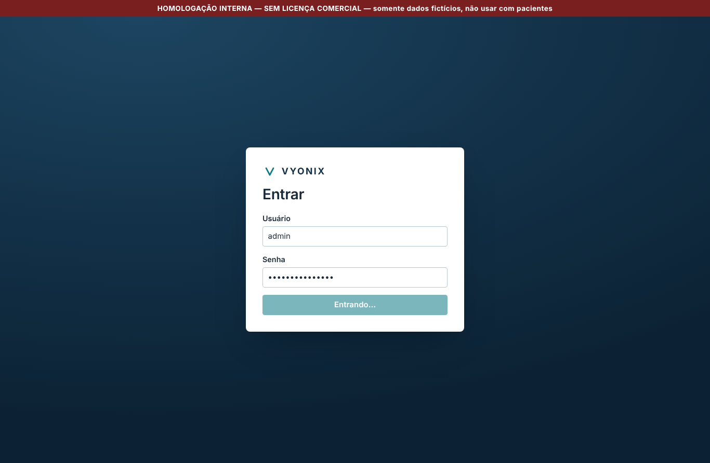
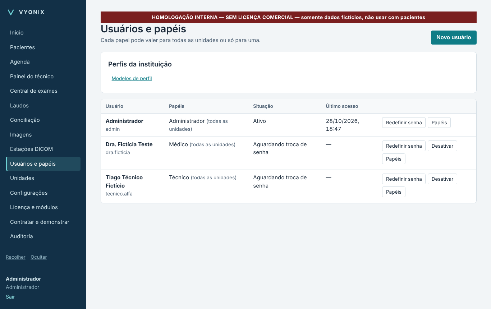
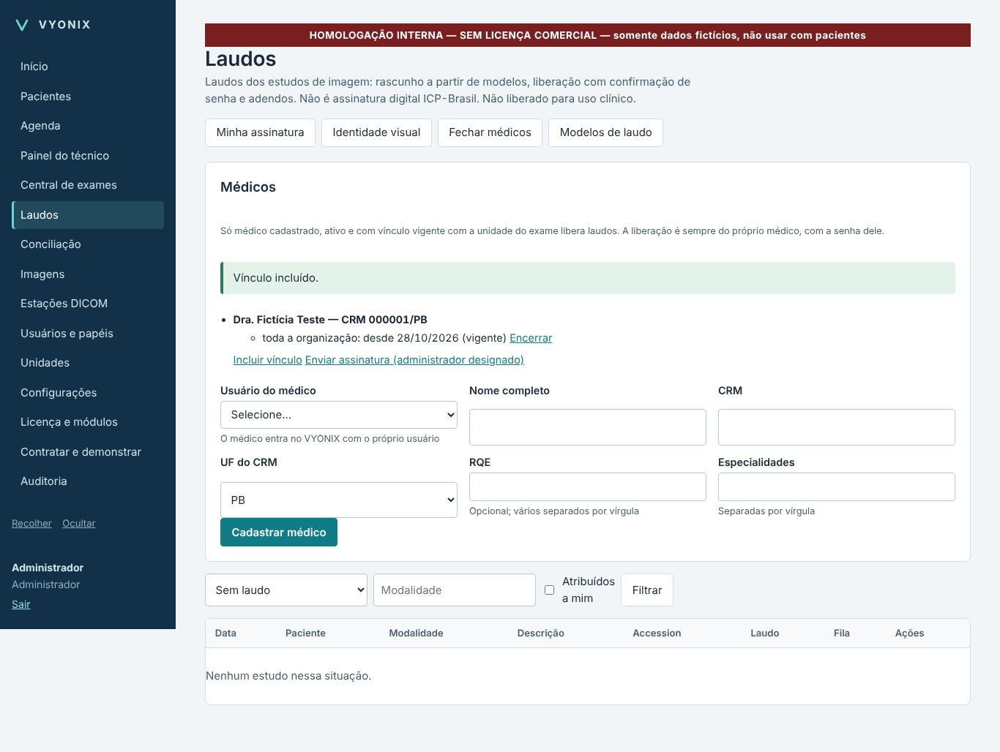
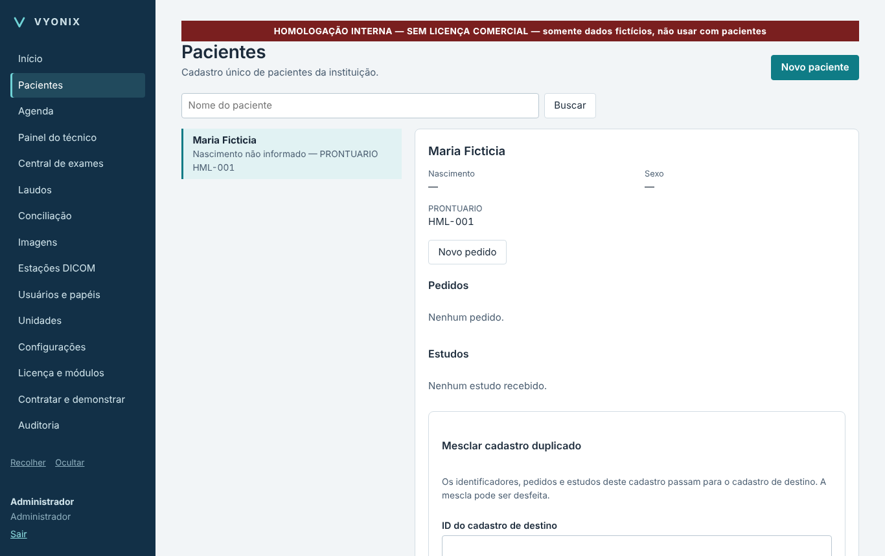
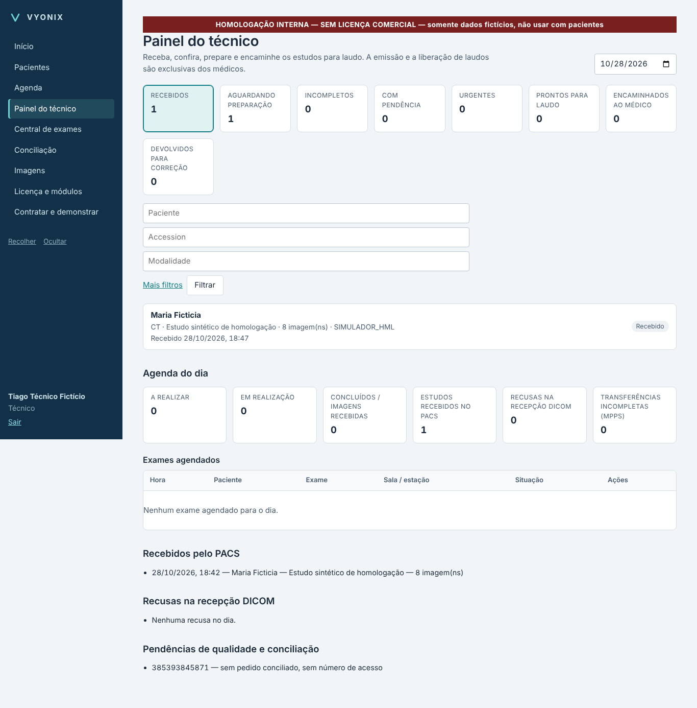
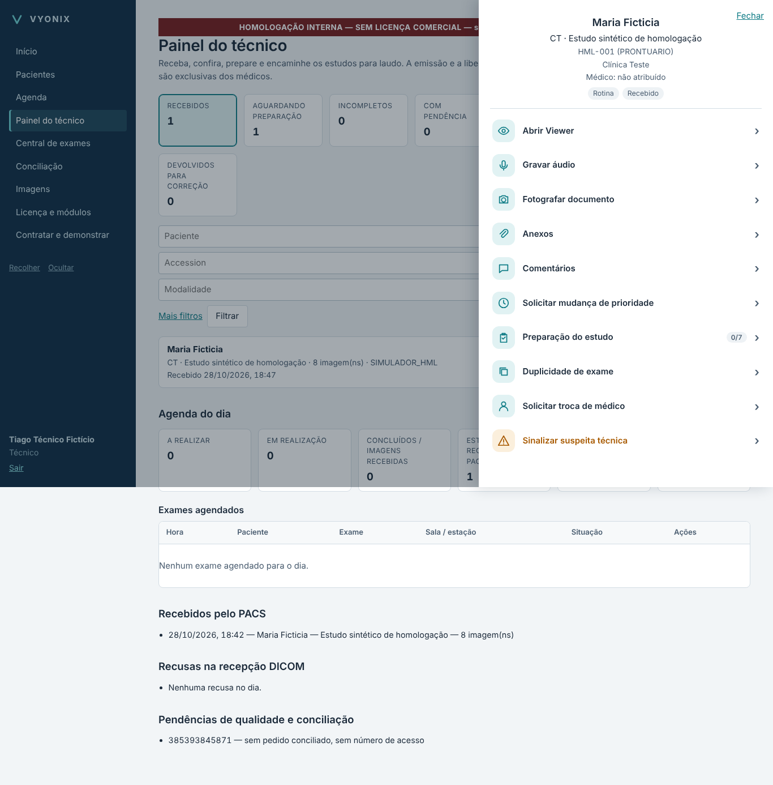
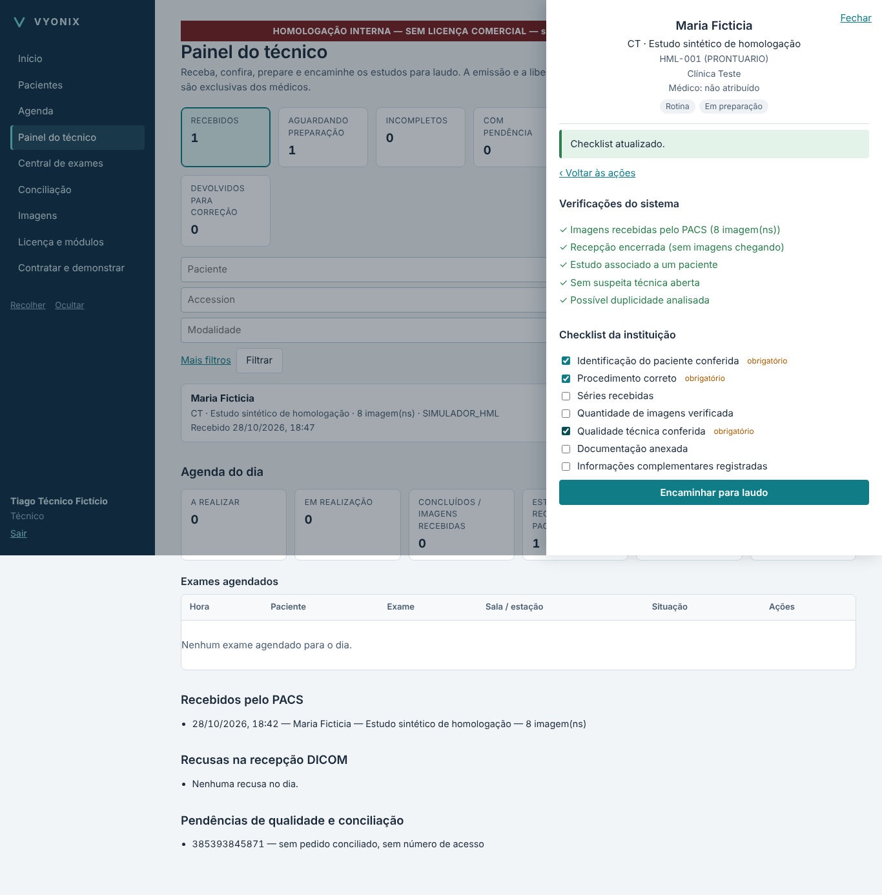
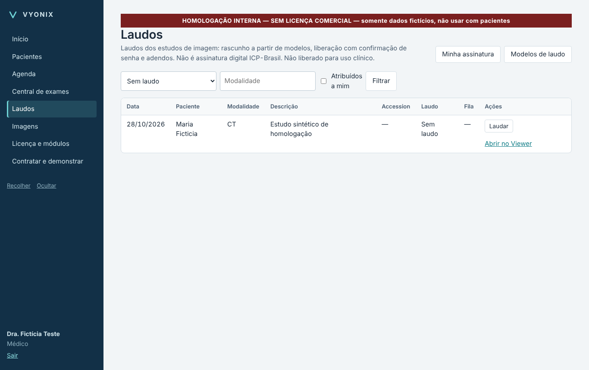

# VYONIX Medical Platform — Auditoria do estado real e liberação da homologação interna

Data: 28/10/2026 · Repositório `well498/VYONIX-DICOMPRINT`, ramo `develop` · Versão candidata: commit **`b8253ba`**
(plataforma `vyonix` 0.2.0) · Variante: **homologação interna** (dados fictícios, sem licença comercial, não clínica).

## A. Resumo executivo

- **Existe uma versão funcional para teste pessoal no Windows:** o instalador `VYONIX_Homologacao_Setup_x64.exe`
  (pipeline *deploy-windows*, execução manual `flavor=homologacao`). Ele instala tudo (sistema web, banco, motor
  DICOM, Viewer), libera PACS, Viewer, RIS e Laudos sem License Manager e traz atalhos para preparar os módulos e
  para enviar um exame simulado. Uso pelo navegador em `https://localhost:8444`, sem comandos de programação.
- **O roteiro pedido funciona de ponta a ponta:** gestor → técnico e médica → paciente → exame DICOM simulado →
  PACS → Central de Exames → Viewer → comentário, anexo, checklist → encaminhamento → fila da médica → laudo e PDF.
  Comprovado (1) pela interface no navegador (`test_e2e_roteiro.py`, capturas abaixo) e (2) no **Windows real do
  CI, pelo próprio instalador**, com o Orthanc oficial (`tools/ci_homolog_acceptance.py`; resultado na seção E).
- **Nada disso é liberação clínica.** Assinatura digital ICP-Brasil, rede de médicos VYONIX entre instituições,
  produção/remuneração e licenciamento integrado ao painel ainda não existem.

## B. Funcionalidades concluídas (com teste executado)

| Área | Disponível na interface | Comprovação |
|---|---|---|
| Acesso só com usuário e senha; senha provisória com troca; bloqueio por tentativas; MFA opcional | Sim | `test_core.py`, e2e |
| Instituições isoladas (RLS), unidades, usuários, papéis, vários papéis por conta, perfis opcionais (Coordenador do CDI, Gestor de Telelaudos, Financeiro, Suporte), delegação limitada | Sim | `test_access_multiinst.py`, e2e |
| Administração global VYONIX (cadastro de instituições, ativar/desativar) — **só no servidor em nuvem** | Sim (nuvem) | `test_platform_admin.py`, `test_e2e_cloud.py` |
| PACS: recepção DICOM (C-STORE no motor e STOW-RS), SHA-256, qualidade, C-FIND/C-MOVE/C-GET pelo Core, nós DICOM, backup verificado e restauração, integridade contínua, retenção (relatório) | Sim (Imagens, Estações DICOM) | `test_pacs*.py`, Orthanc real no CI |
| Viewer OHIF 3.13 na mesma origem (janela/nível, zoom, rotação, inversão, medição sem validação) | Sim | CI viewer (Chromium) |
| RIS: agenda, salas, Modality Worklist, MPPS (com resumo de séries e dose informada), Central de Exames | Sim | `test_ris*.py`, e2e |
| Painel do técnico e preparação do estudo (checklist, verificações fixas, anexos cifrados, foto, áudio, comentários com não lidos, prioridade, duplicidade, suspeitas técnicas, encaminhar, devolver, compartilhar, cancelar) | Sim (computador e celular) | `test_ris_prep.py`, `test_e2e_prep.py` |
| Distribuição (manual, médico fixo, equilibrada) e reserva do médico com expiração | Configurações + fila | `test_ris_prep.py` |
| Laudos: modelos versionados, importação DOCX, médicos e vínculos, fila com prazos, rascunho com prévia "RASCUNHO", liberação com senha, adendos, versões imutáveis, PDF com identidade visual, achado crítico, imagem de assinatura manuscrita, FHIR/HL7/DICOM PDF, liberação em lote | Sim | `test_report*.py`, e2e |
| Instalador e DEPLOY Windows (serviços, firewall, HTTPS, atualização com backup, desinstalação preservando dados e o DICOM Print) | Sim | deploy-windows 29/0/1 (comercial) |
| VYONIX DICOM Print (produto separado): recepção, regras, impressão, licença offline, validação online, demonstração 120 h | Aplicativo próprio | Windows release (testes do Print) |

## C. Funcionalidades parciais

| Área | O que falta |
|---|---|
| Licenciamento centralizado | Emissão de licenças pelo painel da plataforma (hoje: License Manager). Decisão pendente: onde fica a chave de emissão (BLK-01) |
| DICOM Print | Ativação online por código pela plataforma (existem ativação offline e validação online pelo License Server) |
| Viewer | ROI, comparação, sincronização, protocolos de exibição e exportação não verificados; medições sem validação |
| Estação de laudos | Reorganização em painel/estação/perfil, salvamento automático, produção diária |
| RIS | Equipamentos reais (nenhum teste com modalidade real — BLK-02) |

## D. Funcionalidades pendentes (não implementadas)

Assinatura digital PAdES/ICP-Brasil (BLK-14) · médicos da rede VYONIX e compartilhamento entre instituições ·
produção e remuneração médica · faturamento/contratos no painel · acesso excepcional auditado da VYONIX a dado
clínico · exclusão por retenção (exige autorização) · transcrição de áudio (exige avaliação para IA).

## E. Qualidade — testes

| Conjunto | Onde roda | Resultado mais recente |
|---|---|---|
| Plataforma (`tests_platform` + `tests_deploy`), PostgreSQL real, Orthanc real | CI *platform* | **`b8253ba`: 237 testes, 0 pulados, 0 falhas** (Orthanc real, PostgreSQL 17.11; inclui o roteiro e2e e os testes dependentes do Orthanc). Antes: `c9eb30e` 227/0/0 |
| Plataforma local (este ambiente, sem Orthanc) | local | `b8253ba`: 204 testes (202 aprovados + 2 dependentes do Orthanc, que só rodam no CI) + 22 do DEPLOY |
| Viewer (Chromium + Orthanc) | CI *viewer* | `b8253ba`: aprovado |
| Implantação Windows comercial (instala, repara, atualiza, ativa módulo com licença de teste, convive com o DICOM Print r5, desinstala) | CI *deploy-windows* | `c9eb30e`: **aprovado** |
| DICOM Print (339 testes no Windows) | CI *Windows release* | `c9eb30e`: aprovado |
| **Roteiro de homologação no instalador de homologação** (Windows real, Orthanc oficial) | CI *deploy-windows* `flavor=homologacao` | **`b8253ba`, execução 40775100865: aprovado, 13/13 passos** (ver E.1) |
| Testes manuais pela interface | você | roteiro em `Roteiro_Homologacao_Interna_Plataforma.md` |

### E.1 Resultado do instalador de homologação (Windows Server 2022 do CI, 28/10/2026)

Instalador `VYONIX_Homologacao_Setup_x64.exe` — 115,1 MB — SHA-256
`28F6692073D912199A01EB87D6DFF9AAF6CC8479AC41CF438A6C395B7B57111B` · PostgreSQL 17.11 · Orthanc 1.13.0 ·
OHIF 3.13.13 · SBOM: 0 vulnerabilidades conhecidas. Artefato `homologacao-windows`, disponível até 27/11/2026:
https://github.com/well498/VYONIX-DICOMPRINT/actions/runs/40775100865/artifacts/12854608707

| Passo | Resultado |
|---|---|
| 1. Instalar pelo instalador (silencioso, assistente com `clinica-alfa`/`gestor.alfa`) | Aprovado |
| 2. Sistema no ar como homologação interna (`flavor=homologacao`, banco ok) | Aprovado |
| 3. Preparar módulos (PACS com Viewer, RIS, Laudos) | Aprovado |
| 4. Gestor entra só com usuário e senha; módulos habilitados | Aprovado |
| 5. Técnico e médica fictícios; cadastro médico com vínculo | Aprovado |
| 6. Paciente fictícia (prontuário HML-001) | Aprovado |
| 7. Simulador envia 8 imagens por C-STORE ao Orthanc (8 enviadas, 0 falhas) | Aprovado |
| 8. Exame aparece sozinho na Central de Exames (8 imagens, todas as verificações ✓) | Aprovado |
| 9. Viewer e DICOMweb abrem o estudo | Aprovado |
| 10. Comentário, anexo PDF e checklist | Aprovado |
| 11. Encaminhar para laudo | Aprovado |
| 12. Médica vê o exame na fila de laudos | Aprovado |
| 13. Médica redige, libera com senha e baixa o PDF | Aprovado |

O GitHub exibe só 10 avisos por etapa; os passos 11–13 não aparecem como aviso, mas qualquer reprovação gera erro e
faz a etapa falhar — a etapa terminou com sucesso e sem nenhum erro.

Testes automatizados registrados no repositório: Print 326 funções de teste (`tests/`), plataforma 215
(`tests_platform/`), DEPLOY 22, Viewer 3 (cenários longos). Regressão desta entrega: completa na plataforma, porque
as mudanças tocaram licenciamento, PACS, fila de laudos e interface.

## F. Interfaces disponíveis (capturas reais desta versão, dados fictícios)

## G. O que você pode testar imediatamente

Todo o roteiro de `Roteiro_Homologacao_Interna_Plataforma.md`: testes 1 a 11 (inclui laudo com liberação por
senha e PDF). O Viewer abre as imagens sintéticas do simulador.

## H. Bloqueios e limitações para a demonstração

| Item | Situação | Efeito |
|---|---|---|
| Instalador sem assinatura de código | Aguarda certificado (BLK-07 do backlog) | Windows mostra "editor desconhecido" — prosseguir em "Mais informações" |
| Certificado HTTPS autoassinado | Esperado em homologação | Navegador pede confirmação na primeira vez |
| Instalar fora da máquina do DICOM Print | Decisão sua (28/10) | Evita qualquer risco à sua instalação de laboratório |
| Homologação sem licença comercial | Variante própria, identificada em todas as telas | Não serve como teste do licenciamento comercial |
| Windows 10/11 limpos | O CI usa Windows Server 2022 (BLK-04) | Sua instalação será o primeiro teste em Windows de mesa |

## I. Próximos passos

1. Você instala e executa o roteiro; registre falhas com captura e horário.
2. Corrigimos o que aparecer antes de qualquer funcionalidade grande nova (conforme sua instrução).
3. Em seguida: decisão sobre a chave de emissão (BLK-01) para integrar o licenciamento ao painel.
