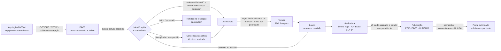

# Fluxo operacional integrado — conceitos divulgados pela RadCloud × VYONIX atual (29/10/2026, 21:54)

**Fonte da referência:** mensagem do proprietário descrevendo seis imagens da apresentação pública da RadCloud.
**As imagens não chegaram anexadas** (só o texto); a análise usa os seis conceitos descritos e as fontes R1–R7 de
`Fase_B_Benchmarking_Brasil.md`. Classe de todos os conceitos: **DECLARADO PELO FORNECEDOR** (material de
apresentação; não demonstra a interface interna). Nenhuma funcionalidade interna é presumida.

## 1. Comparativo conceito × VYONIX (com evidência no código)
| # | Conceito divulgado (RadCloud) | VYONIX hoje | Situação |
|---|---|---|---|
| 1 | Integração nativa PACS + RIS + telerradiologia | Um único Core: PACS (motor Orthanc embutido, DICOMweb), RIS (agenda, MWL/MPPS, Central de Exames, preparo), Laudos (fila, editor, revisão, liberação) no mesmo banco e na mesma interface (`vyonix/pacs`, `vyonix/ris`, `vyonix/report`) | **Implementado**; integração entre telas a melhorar (UX-A-001/006/009) |
| 2 | Envio automático de imagens DICOM | C-STORE do equipamento → motor PACS → indexação pelo Worker → estudo clínico registrado e ligado ao paciente por (emissor, PatientID) (`pacs/service.py:183`, `clinical/service.py:340`); política de recepção "só equipamentos cadastrados" e retenção (`pacs/nodes.py`); STOW-RS; modo nuvem (`cloud_sync`) | **Implementado**; riscos: cursor de indexação (A03-005), política na nuvem (A03-006) |
| 3 | Análise e laudo por radiologistas autorizados | Fila com escopo por vínculo/unidade, atribuição, prioridade e prazo (`report/queue.py`), editor rico, frases, modelos, revisão, liberação por senha; compartilhamento `report` com escopo correto (`c725108`) | **Implementado, melhorar**: trava de autoria (A05-003), habilitação por modalidade (matriz #7), prazo visível (#3) |
| 4 | Disponibilização online de resultados | PDF do laudo, "Guardar no PACS" (DICOM PDF), FHIR/HL7 de saída (`report/interop.py`); **sem entrega online a paciente/solicitante** | **Parcial** |
| 5 | Portal integrado para médicos e pacientes | Não existe (requisito P2; BLK-06); "solicitante" é texto livre no pedido; compartilhamento só interno entre profissionais | **Ausente** (depende de conformidade) |
| 6 | Gestão unificada, escalabilidade, assinatura ICP-Brasil | Gestão por instituição com unidades, contas independentes (decisão aprovada), modo local/nuvem; liberação por senha + imagem da assinatura; **PAdES/ICP-Brasil preparado e bloqueado** (`report/pades.py`, BLK-14); escalabilidade não medida (NV-05, A03-003/010) | **Parcial** |

## 2. Fluxograma operacional integrado (proposto; transições com regra, permissão e trilha)

### Regras por transição
| Transição | Regra de negócio / validação | Permissão (backend) | Trilha | Situação |
|---|---|---|---|---|
| Aquisição → PACS | Recepção só de equipamento cadastrado quando a política exigir; integridade SHA-256; UID conflitante recusado | AE/IP cadastrados | `pacs.*` + retidos | OK (nuvem: A03-006) |
| PACS → Identificação | Paciente por (emissor, PatientID); pedido por número de acesso; nunca por nome | — (automático) | `study.register` | OK; issuer no índice do PACS para o OHIF: A03-007 |
| Conferência | Checklist obrigatório configurável; divergência → conciliação assistida; mescla com motivo e desfazer | `ris.exam.prepare`, `clinical.studies.reconcile` | `ris.prep.*`, `clinical.*` | PAR — busca assistida (UX-A-016), lote (UX-A-007) |
| Distribuição | Prazo por prioridade; automática sem preparo exigido (A05-012); trava de autoria (A05-003) | `report.assign` | `report.assign*` | MEL |
| Viewer | Escopo por vínculo configurável; WADO com auditoria por série (A03-012) | `pacs.studies.read` | `pacs.study.open` | OK / MEL |
| Laudo | Bloquear abrir/editar/liberar com exame cancelado, devolvido ou não encaminhado (A05-005); `row_version` obrigatório | `report.write` (+ escopo) | `report.*` versões com hash | **MEL (P1)** |
| Assinatura | Liberação por senha hoje; ICP-Brasil quando BLK-14 decidido; nunca "assinatura" para imagem | `report.finalize` | versão imutável | PAR (BLK-14) |
| Publicação | **Nunca publicar laudo não assinado ou de estudo com pendência impeditiva** (cancelado, devolvido, achado crítico não comunicado quando exigido) | regra no serviço, não na tela | `report.published` (a criar) | A especificar (P1 na regra; P2 nos canais) |
| Portal | Só após aprovação de segurança/privacidade/conformidade (BLK-06); compartilhamento com validade e revogação | perfis novos | acesso registrado | Ausente (DEC) |

## 3. Integração sem retrabalho — oportunidades
| Tema | VYONIX hoje | Oportunidade | Pri |
|---|---|---|---|
| Evitar recadastro de paciente | Identificador por emissor com unicidade (`add_identifier` recusa duplicado); estudo liga sozinho por (emissor, PatientID) | Cadastro a partir do estudo recebido sem pedido (pré-preencher com metadados DICOM, confirmação humana); receptor HL7 ADT (P2 já registrado) | P2 |
| Sincronizar estados do exame | Agenda (MWL/MPPS), preparo e laudo com estados próprios; Agenda × Painel divergem (UX-A-009); pedido preso (A05-006/007); transições sem matriz (A05-008) | Máquina de estados única do exame (agendado → chegou → em exame → recebido → conferido → encaminhado → em laudo → assinado → publicado), cancelamento em cascata | **P1** |
| Preservar metadados DICOM | Arquivos intactos com SHA-256; índice com campos principais | Guardar issuer e metadados completos no índice (A03-003/007) | P1/P2 |
| Reduzir transferências manuais | Conciliação manual por número de acesso | Sugestão automática por (emissor, ID, data, modalidade) com confirmação | P2 |
| Encaminhamentos autorizados | Encaminhamento DICOM por regra (`pacs/forward.py`) com limitações (A03-009) | Contextos alternativos, retomada, imagens tardias | P2 |
| Resultados conforme permissão | Escopo por vínculo, compartilhamento com escopo (corrigido) | Publicação condicionada (acima) e perfis solicitante/paciente (DEC) | P1/P2 |
| Auditoria | Trilha encadeada SHA-256 em todas as ações sensíveis | Leitura humana da trilha (UX-A-014), WADO por série (A03-012) | P2 |
| Falhas de integração | Retidos na recepção, quarentena na nuvem, erros do motor como 503 | Arquivo ausente → 409 + auditoria (A03-011); regressão de sequência do índice (A03-005) | P0/P2 |

## 4. Assinatura digital (investigação; sem implementação)
* Três coisas distintas, já separadas no código e nas telas (`report/pades.py`): confirmação por senha (identifica
  quem libera), imagem da assinatura manuscrita (elemento visual) e **assinatura digital PAdES/ICP-Brasil**
  (validade jurídica do PDF, não disponível — BLK-14).
* Requisitos a decidir no BLK-14: tipo de certificado (A1 arquivo, A3 token/cartão, certificado em nuvem com PSC),
  carimbo do tempo, validação do documento pelo destinatário (ITI/validar.iti.gov.br), assinatura em lote, guarda
  das evidências. Referências normativas citadas pela pesquisa: CFM 2.314/2022 art. 13, CFM 2.107/2014 art. 10,
  Lei 14.063/2020 — **sem declarar conformidade**.
* Responsabilidade do profissional preservada: só o médico assina; não existe liberar "em nome de" outro médico.

## 5. Backlog derivado (consolidado em `VYONIX_NEXT_ACTION.md`)
| ID | Item | Pri | Agente | Critério de aceitação |
|---|---|---|---|---|
| INT-01 | Regra de publicação no serviço: só laudo assinado e estudo sem pendência impeditiva (inclui A05-005) | P1 | 05+04 | Testes: cancelado/devolvido/não encaminhado → 409; publicação registrada na trilha |
| INT-02 | Máquina de estados única do exame + cancelamento em cascata (A05-006/007/008) | P1 | 05 | Matriz de transições testada; Agenda e Painel com as mesmas ações |
| INT-03 | Prazo visível na fila do médico (matriz #3; R7) | P1 | 05+UX | Coluna de prazo com texto + faixa; ordenação padrão |
| INT-04 | Contexto do estudo dentro do laudo e "devolver" (UX-A-001) | P1 | UX+05 | Médico vê comentários/anexos/checklist e devolve com motivo |
| INT-05 | Cadastro de paciente a partir do estudo sem pedido, com confirmação | P2 | 05 | Sem duplicar identificador; auditado |
| INT-06 | Sugestão automática de conciliação | P2 | 05+03 | Nunca associar sem confirmação humana |
| INT-07 | Perfis e portal do solicitante e do paciente | P2 (DEC: BLK-06) | 05+04+UX | Só após aprovação |
| INT-08 | Assinatura PAdES/ICP-Brasil | P1 após BLK-14 (DEC) | 05+04 | Validação no ITI; laudo imutável |
